  

# 🚀 Awesome Multi-Channel Customer Messaging

 

> 🌟 **A curated list of top Multi-Channel Customer Messaging platforms** — spanning enterprise SaaS/Hosted commercial suites and extensible open-source alternatives for unifying customer conversations across live chat, email, WhatsApp, SMS, social channels, and AI copilots.
>
> 🎯 *Star this repository if you find it helpful for your stack architecture, helpdesk selection, or customer support operations!*

---

## 🧭 Navigation & Table of Contents

- [📈 Sector Overview & Market Dynamics](#-sector-overview--market-dynamics)
- [🏢 SaaS / Hosted Platforms](#-saas--hosted-platforms)
  - [📊 SaaS Pricing, Scale & Free Tier Comparison](#-saas-pricing-scale--free-tier-comparison)
  - [🔍 SaaS Platform Profiles](#-saas-platform-profiles)
- [💻 Open-Source Software](#-open-source-software)
  - [⭐ Open-Source Software Ranked by Stars](#-open-source-software-ranked-by-stars)
  - [🛠️ Deep-Dive Open-Source Profiles](#️-deep-dive-open-source-profiles)
- [⚖️ Architectural & Feature Matrix](#️-architectural--feature-matrix)
- [🤝 Contributing Guidelines](#-contributing-guidelines)
- [⭐ Star History](#-star-history)
- [💖 Support & Sponsor](#-support--sponsor)
- [📜 License](#-license)

---

## 📈 Sector Overview & Market Dynamics

The global business messaging and customer communications market is valued at approximately **$25.6 billion** and is projected to expand toward **$98.4 billion**, registering a robust **14.4% CAGR**. The sector exhibits a **moderately fragmented landscape** across SMB and mid-market segments—driven by low SaaS entry barriers and evolving conversational channels like WhatsApp, SMS, and RCS—coexisting with high concentration at the enterprise tier where legacy incumbents (e.g., Zendesk, Salesforce) command major market shares.

---

## 🏢 SaaS / Hosted Platforms

Commercial, cloud-hosted Multi-Channel Customer Messaging platforms. These proprietary solutions deliver fully managed infrastructure, enterprise compliance, and turnkey AI agent integrations.

### 📊 SaaS Pricing, Scale & Free Tier Comparison

The table below benchmarks commercial providers sorted by company size (valuation / revenue) in descending order:

| 🏷️ Platform | 💰 Company Scale (Valuation / Revenue) | 💳 Starting Tier Pricing | 🎁 Free Tier / Free Trial Limits | 🎯 Primary Focus |
|:---|:---|:---|:---|:---|
| **[Zendesk](https://www.zendesk.com/)** | **$10.2B** acquisition valuation (~$2.0B ARR) | **$19** /agent/month (Support Team billed annually; Suite Omnichannel starts at **$55** /agent/month) | **14-day free trial** (Full access to Suite Professional features, no credit card required) | Enterprise omnichannel ticketing, helpdesk & CRM |
| **[Intercom](https://www.intercom.com/)** | **$3.6B** acquisition valuation (~$400M ARR) | **$29** /seat/month (Essential plan billed annually; Fin AI agent billed at $0.99/resolution) | **14-day free trial** (Full platform access including Fin AI trial credits) | Conversational support & AI-first messenger workflows |
| **[Front](https://front.com/)** | **$1.7B** valuation (~$100M+ ARR) | **$25** /seat/month (Starter tier billed annually, up to 10 seats) | **14-day free trial** (Full Professional tier access for teams, no credit card required) | Collaborative shared email inbox & multi-channel routing |
| **[Drift](https://www.drift.com/)** | **$1.0B+** valuation (~$120M ARR, Salesloft group) | **$2,500** /month (Premium tier billed annually at $30,000/yr, includes 1 seat & core bot builder) | **No self-serve free trial** (Sandbox evaluation only available via guided sales demo) | Conversational B2B marketing, sales acceleration & pipeline booking |
| **[LivePerson](https://www.liveperson.com/)** | **~$243.7M** annual revenue (~$140M market cap) | **$4,166** /month (~$50,000/year entry-level enterprise contract commitment) | **No public free trial** (Enterprise discovery call & proof-of-concept environment required) | High-volume enterprise conversational AI & contact center scale |
| **[Trengo](https://trengo.com/)** | **$100M–$250M** valuation (~$17.9M ARR) | **€299** /month (Boost plan billed annually, covers up to 10 users & unified channels) | **7-day free trial** (Full access to multi-channel inbox and WhatsApp integration) | Shared team inbox & WhatsApp/email business operations |
| **[Tidio](https://www.tidio.com/)** | **~$100M+** valuation (~$48.4M ARR) | **$29** /month (Starter plan; billed monthly or annually) | **Free forever plan** (Up to 10 operator seats, capped at 50 billable conversations/month) | SMB website live chat widget & Lyro AI customer automation |
| **[Crisp](https://crisp.chat/)** | **$15M–$30M** valuation estimate (~$1.4M ARR, bootstrapped) | **$45** /workspace/month (Mini plan includes 4 seats; Essentials at $95/month includes 10 seats) | **Free forever plan** (Up to 2 operator seats, basic website chat widget & 30-day history) | All-in-one team inbox, live chat & CRM for startups/SMBs |

---

### 🔍 SaaS Platform Profiles

#### 💬 Intercom
* **Company Status & Scale:** Acquired by Salesforce for $3.6B (~$400M ARR).
* **Architecture & Focus:** Pioneered the modern in-app messenger experience for product-led businesses. Unifies email, live chat, self-service knowledge base, and proactive outbound product tours.
* **AI Capabilities:** Incorporates Fin AI Agent, operating on an outcome-based resolution pricing model ($0.99 per resolved query).

#### 🎫 Zendesk Messaging
* **Company Status & Scale:** Taken private by Hellman & Friedman and Permira for $10.2B (~$2.0B ARR).
* **Architecture & Focus:** Deep enterprise customer ticketing suite extending into conversational messaging across web, mobile SDKs, WhatsApp, and social networks.
* **AI Capabilities:** Proprietary Zendesk AI for intent recognition, smart triage, macro suggestions, and copilot agent guidance.

#### 🎯 Drift (by Salesloft)
* **Company Status & Scale:** Acquired by Vista Equity Partners at a $1.0B+ valuation (~$120M ARR).
* **Architecture & Focus:** Conversational marketing and buyer acceleration engine built to replace traditional lead forms with interactive chatbots and instant meeting schedulers.

#### ⚡ Crisp
* **Company Status & Scale:** High-margin bootstrapped SaaS (~$1.4M ARR).
* **Architecture & Focus:** Lightweight yet powerful shared customer workspace delivering web live chat, email forwarding, Instagram DM, Telegram, and status pages within flat-rate workspaces.

#### 🤖 Tidio
* **Company Status & Scale:** Series B ($26.8M funded, ~$48.4M revenue).
* **Architecture & Focus:** Highly accessible live chat widget engineered for e-commerce (Shopify, WordPress) paired with visual trigger workflows.
* **AI Capabilities:** Powers conversational deflection with Lyro conversational AI.

#### 📞 LivePerson
* **Company Status & Scale:** Public enterprise vendor (NASDAQ: LPSN, ~$243.7M revenue).
* **Architecture & Focus:** Enterprise Conversational Cloud serving telecommunications, banking, and global retail with asynchronous messaging across Apple Messages for Business, WhatsApp, SMS, and web.

#### 📥 Trengo
* **Company Status & Scale:** Series A ($36M funded led by Insight Partners, ~$17.9M ARR).
* **Architecture & Focus:** Centralized team inbox aggregating WhatsApp Business API, voice, email, and live chat into a single collaborative pane of glass.

#### 🤝 Front
* **Company Status & Scale:** Series D unicorn ($1.7B valuation, $100M+ ARR).
* **Architecture & Focus:** Reimagines shared company inboxes (`support@`, `sales@`) as collaborative workspaces with collision detection, internal comments, assignments, and cross-channel sync.

---

## 💻 Open-Source Software

Self-hosted, transparent, and data-sovereign customer messaging engines. These projects provide complete control over user data, on-premises deployment, and custom LLM integrations without recurring per-seat fees.

### ⭐ Open-Source Software Ranked by Stars

The table below lists open-source customer messaging and conversational helpdesk repositories ranked in descending order by GitHub stargazers:

| 🏆 Project | ⭐ GitHub Stars | 📜 License | 🛠️ Tech Stack | 🌐 Omnichannel Coverage |
|:---|:---|:---|:---|:---|
| **[Rocket.Chat](https://github.com/RocketChat/Rocket.Chat)** |  | GPL-3.0 | TypeScript, Node.js, MongoDB | Omnichannel live chat, WhatsApp, Instagram, Telegram, SMS |
| **[Chatwoot](https://github.com/chatwoot/chatwoot)** |  | MIT | Ruby on Rails, Vue.js, PostgreSQL, Redis | Website live chat, Email, WhatsApp, Telegram, Twitter/X, SMS |
| **[Rasa](https://github.com/RasaHQ/rasa)** |  | Server Side Public License | Python, TensorFlow/PyTorch | Conversational AI across Slack, Web, WhatsApp, Messenger |
| **[Botpress](https://github.com/botpress/botpress)** |  | AGPL-3.0 / Elastic-2.0 | TypeScript, React, Node.js | Multi-channel conversational chatbot orchestration |
| **[Typebot](https://github.com/baptisteArno/typebot.io)** |  | AGPL-3.0 | TypeScript, Next.js, Prisma, PostgreSQL | Embeddable conversational forms, WhatsApp, web apps |
| **[Papercups](https://github.com/papercups-io/papercups)** |  | MIT | Elixir, Phoenix, React, PostgreSQL | Lightweight web live chat, Slack sync, email support |
| **[Zammad](https://github.com/zammad/zammad)** |  | AGPL-3.0 | Ruby on Rails, PostgreSQL, Elasticsearch | Email, Phone/CTI, Twitter/X, Facebook, Telegram, WhatsApp |
| **[FreeScout](https://github.com/freescout-help-desk/freescout)** |  | AGPL-3.0 | PHP, Laravel, MySQL/MariaDB | Email shared inbox, WhatsApp, Telegram, Webhooks |
| **[Chaskiq](https://github.com/chaskiq/chaskiq)** |  | AGPL-3.0 + Commons Clause | Ruby on Rails, React, PostgreSQL | Live chat, WebRTC video calls, mailing campaigns, bots |
| **[Frappe Helpdesk](https://github.com/frappe/helpdesk)** |  | GPL-3.0 | Python, Frappe Framework, Vue.js | Omnichannel ticketing, email queues, portal, live SLA tracking |
| **[Live Helper Chat](https://github.com/LiveHelperChat/livehelperchat)** |  | Apache-2.0 | PHP, JavaScript, MySQL | Live chat widget, Telegram, WhatsApp, voice call redirect |
| **[Trudesk](https://github.com/polonel/trudesk)** |  | Apache-2.0 | Node.js, MongoDB, Elasticsearch | Real-time support ticketing, team tasks, email piping |
| **[opendesk](https://github.com/timrolls/Opendesk)** |  | AGPL-3.0 | Go, Elixir, PostgreSQL | Real-time shared inbox, web live chat, Ollie AI assistant |
| **[Tiledesk](https://github.com/Tiledesk/tiledesk)** |  | MIT | Node.js, Express, MongoDB, Docker | Visual chatbot design, multichannel human handoff |
| **[ChatterMate](https://github.com/chattermate/chattermate.chat)** |  | Apache-2.0 | TypeScript, Next.js, Node.js | Multi-channel AI agent, MCP server tools, BYO LLM |

---

### 🛠️ Deep-Dive Open-Source Profiles

#### 🚀 [Rocket.Chat](https://github.com/RocketChat/Rocket.Chat)
* **GitHub Repository:** [`RocketChat/Rocket.Chat`](https://github.com/RocketChat/Rocket.Chat) | **Stars:** 
* **Tech Stack:** TypeScript / Node.js / MongoDB | **License:** GPL-3.0
* **Core Strengths:** Enterprise-grade secure communication platform with a powerful Omnichannel customer service module. Unifies web chat widgets, WhatsApp, Instagram, Telegram, SMS, and Twitter into a single agent console with enterprise RBAC and compliance certifications (HIPAA, GDPR).

#### 💬 [Chatwoot](https://github.com/chatwoot/chatwoot)
* **GitHub Repository:** [`chatwoot/chatwoot`](https://github.com/chatwoot/chatwoot) | **Stars:** 
* **Tech Stack:** Ruby on Rails / Vue.js / PostgreSQL / Redis | **License:** MIT
* **Core Strengths:** Widely regarded as the leading open-source alternative to Intercom and Zendesk. Features a unified omnichannel inbox supporting live website widgets, Facebook, Instagram, Twitter/X, Telegram, WhatsApp, Line, Twilio SMS, and standard email routing. Offers native mobile apps (iOS & Android) and contact CRM attributes.

#### 🧠 [Rasa](https://github.com/RasaHQ/rasa)
* **GitHub Repository:** [`RasaHQ/rasa`](https://github.com/RasaHQ/rasa) | **Stars:** 
* **Tech Stack:** Python / TensorFlow / PyTorch | **License:** Server Side Public License
* **Core Strengths:** Industrial-strength conversational AI framework for building contextual AI assistants across customer channels. Provides full control over enterprise conversational training data without vendor lock-in.

#### 🤖 [Botpress](https://github.com/botpress/botpress)
* **GitHub Repository:** [`botpress/botpress`](https://github.com/botpress/botpress) | **Stars:** 
* **Tech Stack:** TypeScript / React / Node.js | **License:** AGPL-3.0 / Elastic-2.0
* **Core Strengths:** Developer-centric conversational flow platform designed for designing, building, and deploying generative AI chatbots and agentic customer messaging workflows across web and messaging endpoints.

#### 📝 [Typebot](https://github.com/baptisteArno/typebot.io)
* **GitHub Repository:** [`baptisteArno/typebot.io`](https://github.com/baptisteArno/typebot.io) | **Stars:** 
* **Tech Stack:** TypeScript / Next.js / Prisma / PostgreSQL | **License:** AGPL-3.0
* **Core Strengths:** Visual conversational flow builder that turns traditional forms into interactive conversational experiences. Easily embeds into any website or WhatsApp channel with real-time webhooks and native OpenAI/Anthropic blocks.

#### ⚡ [Papercups](https://github.com/papercups-io/papercups)
* **GitHub Repository:** [`papercups-io/papercups`](https://github.com/papercups-io/papercups) | **Stars:** 
* **Tech Stack:** Elixir / Phoenix / React / PostgreSQL | **License:** MIT
* **Core Strengths:** Lightweight and clean Elixir-based live customer chat engine with bi-directional Slack synchronization. *(Note: Main repository is in community maintenance mode; ideal for teams seeking a lean Elixir codebase to fork).*

#### 🛡️ [Zammad](https://github.com/zammad/zammad)
* **GitHub Repository:** [`zammad/zammad`](https://github.com/zammad/zammad) | **Stars:** 
* **Tech Stack:** Ruby on Rails / PostgreSQL / Elasticsearch | **License:** AGPL-3.0
* **Core Strengths:** Modern web-based helpdesk delivering one of the most polished user experiences in the open-source ecosystem. Integrates email piping, telephony (CTI), Twitter/X, Facebook, Telegram, and WhatsApp into an ITIL-compliant ticketing and knowledge base environment.

#### 📮 [FreeScout](https://github.com/freescout-help-desk/freescout)
* **GitHub Repository:** [`freescout-help-desk/freescout`](https://github.com/freescout-help-desk/freescout) | **Stars:** 
* **Tech Stack:** PHP / Laravel / MySQL / MariaDB | **License:** AGPL-3.0
* **Core Strengths:** Super-lightweight, self-hosted Help Scout alternative designed to run on minimal server resources. Provides collision detection, unlimited mailboxes, multilingual support, and a rich modular marketplace for WhatsApp, SLA triggers, and custom fields.

#### 📹 [Chaskiq](https://github.com/chaskiq/chaskiq)
* **GitHub Repository:** [`chaskiq/chaskiq`](https://github.com/chaskiq/chaskiq) | **Stars:** 
* **Tech Stack:** Ruby on Rails / React / PostgreSQL / Redis | **License:** AGPL-3.0 + Commons Clause
* **Core Strengths:** Conversational platform combining live chat, rich text campaigns, bots, and WebRTC video calling directly in the customer messenger interface.

#### 📋 [Frappe Helpdesk](https://github.com/frappe/helpdesk)
* **GitHub Repository:** [`frappe/helpdesk`](https://github.com/frappe/helpdesk) | **Stars:** 
* **Tech Stack:** Python / Frappe Framework / Vue.js | **License:** GPL-3.0
* **Core Strengths:** Clean, fast, and modern open-source customer support tool built on the Frappe framework. Features ticket assignment, SLA rules, email sync, customer portal, and native Frappe/ERPNext ecosystem synergy.

#### 💬 [Live Helper Chat](https://github.com/LiveHelperChat/livehelperchat)
* **GitHub Repository:** [`LiveHelperChat/livehelperchat`](https://github.com/LiveHelperChat/livehelperchat) | **Stars:** 
* **Tech Stack:** PHP / JavaScript / MySQL | **License:** Apache-2.0
* **Core Strengths:** Mature, highly flexible live chat software supporting web chat, co-browsing, Telegram, WhatsApp, and Facebook Messenger with low memory footprint and extensive third-party webhook integrations.

#### 🎫 [Trudesk](https://github.com/polonel/trudesk)
* **GitHub Repository:** [`polonel/trudesk`](https://github.com/polonel/trudesk) | **Stars:** 
* **Tech Stack:** Node.js / MongoDB / Elasticsearch | **License:** Apache-2.0
* **Core Strengths:** Open-source helpdesk ticketing system designed for speed and real-time collaboration. Includes ticket management, internal tasks, customer accounts, and email pipelining.

#### ⚡ [opendesk](https://github.com/timrolls/Opendesk)
* **GitHub Repository:** [`timrolls/Opendesk`](https://github.com/timrolls/Opendesk) | **Stars:** 
* **Tech Stack:** Go / Elixir / PostgreSQL | **License:** AGPL-3.0
* **Core Strengths:** High-performance Go and Elixir helpdesk delivering real-time shared inbox synchronization, embedded website chat, public documentation portal, and built-in Ollie AI assistant supporting local and frontier LLMs.

#### 🔀 [Tiledesk](https://github.com/Tiledesk/tiledesk)
* **GitHub Repository:** [`Tiledesk/tiledesk`](https://github.com/Tiledesk/tiledesk) | **Stars:** 
* **Tech Stack:** Node.js / Express / MongoDB / Docker | **License:** MIT
* **Core Strengths:** Low-code conversational workflow designer coupling rule-based & LLM chatbots with smooth human agent handoff across WhatsApp Business, website widgets, and mobile channels.

#### 🤖 [ChatterMate](https://github.com/chattermate/chattermate.chat)
* **GitHub Repository:** [`chattermate/chattermate.chat`](https://github.com/chattermate/chattermate.chat) | **Stars:** 
* **Tech Stack:** TypeScript / Next.js / Node.js | **License:** Apache-2.0
* **Core Strengths:** AI-first customer support agent supporting human handoff, omnichannel ingestion (Web, WhatsApp, Instagram, Messenger, Slack, Email), MCP tool integration, and bring-your-own LLM architecture with read-only database guardrails.

---

## ⚖️ Architectural & Feature Matrix

| 🌟 Platform / Repository | 📦 Deployment Type | 📜 License | 🗄️ Core Stack | 🌐 Omnichannel Channels | 🤖 AI Capabilities | 👥 Best Suited For |
|:---|:---|:---|:---|:---|:---|:---|
| **Intercom** | Hosted SaaS | Proprietary | Cloud | Web, Mobile, Email, Social | Fin AI ($0.99/res) | Product-led SaaS & conversational marketing |
| **Zendesk** | Hosted SaaS | Proprietary | Cloud | Web, Mobile, Email, WhatsApp, Social | Zendesk AI Copilot | Mid-market & enterprise ticket workflows |
| **Front** | Hosted SaaS | Proprietary | Cloud | Email, SMS, WhatsApp, Live Chat | Front Copilot & Smart QA | Collaborative team email & shared operations |
| **Drift** | Hosted SaaS | Proprietary | Cloud | Web Chat, Email, Video | Bionic Chatbots & AI playbooks | B2B sales acceleration & revenue teams |
| **LivePerson** | Hosted SaaS | Proprietary | Cloud | Web, In-App, WhatsApp, Apple Messages | Conversational Cloud AI | Enterprise contact centers & global brands |
| **Trengo** | Hosted SaaS | Proprietary | Cloud | WhatsApp, Email, Live Chat, Voice | Trengo AI Assistant | Unified WhatsApp & communication inboxes |
| **Tidio** | Hosted SaaS | Proprietary | Cloud | Web Chat, Messenger, Instagram, Email | Lyro AI agent | E-commerce stores & SMB live chat |
| **Crisp** | Hosted SaaS | Proprietary | Cloud | Web Chat, Email, Telegram, Instagram | Hugo AI assistant | Startups & SMB cost-effective team chat |
| **Rocket.Chat** | Self-Hosted / Cloud | GPL-3.0 | TypeScript / Node / Mongo | Web, WhatsApp, Instagram, SMS | AI Agent connectors & LLM hooks | Enterprise compliance, privacy & on-premise scale |
| **Chatwoot** | Self-Hosted / Cloud | MIT | Rails / Vue / PostgreSQL | Web, Email, WhatsApp, Social, SMS | Captain AI & BYO LLM | Open-source alternative to Intercom & Zendesk |
| **Rasa** | Self-Hosted / Cloud | SSPL | Python / PyTorch / TensorFlow | Slack, Web, WhatsApp, Messenger | Deep NLU & enterprise dialogue models | Custom enterprise conversational AI pipelines |
| **Botpress** | Self-Hosted / Cloud | AGPL / Elastic | TypeScript / React / Node | Web, WhatsApp, Telegram, Slack | Generative LLM agent builder | Developers crafting intelligent bot flows |
| **Typebot** | Self-Hosted / Cloud | AGPL-3.0 | Next.js / Prisma / Postgres | Web Embed, WhatsApp | Native OpenAI/Anthropic nodes | Visual conversational form automation |
| **Papercups** | Self-Hosted / Cloud | MIT | Elixir / Phoenix / Postgres | Web Live Chat, Slack Sync | Webhook integrations | Elixir engineering teams needing custom chat |
| **Zammad** | Self-Hosted / Cloud | AGPL-3.0 | Rails / Postgres / Elasticsearch | Email, Phone/CTI, Social, WhatsApp | Integration hooks | Polish-first open-source helpdesk & ticketing |
| **FreeScout** | Self-Hosted | AGPL-3.0 | PHP / Laravel / MySQL | Email, WhatsApp, Telegram | Add-on modules | Lean infrastructure & email-first support |
| **Chaskiq** | Self-Hosted | AGPL + Commons | Rails / React / PostgreSQL | Live Chat, Video Calls, Email | Automated conversational bots | Rich media messaging & video engagement |
| **Frappe Helpdesk** | Self-Hosted / Cloud | GPL-3.0 | Python / Frappe / Vue | Email, Customer Portal, Web | Frappe AI assistant hooks | Teams within the Frappe & ERPNext ecosystem |
| **Live Helper Chat** | Self-Hosted | Apache-2.0 | PHP / MySQL | Web Chat, WhatsApp, Telegram | Bot builders & webhook hooks | High-traffic lightweight on-premise chat |
| **Trudesk** | Self-Hosted | Apache-2.0 | Node.js / MongoDB | Email piping, Web Desk | Search & notification triggers | Open-source real-time ticketing |
| **opendesk** | Self-Hosted | AGPL-3.0 | Go / Elixir / PostgreSQL | Live Chat, Shared Email | Ollie AI assistant | High-performance Go-stack modern helpdesk |
| **Tiledesk** | Self-Hosted / Cloud | MIT | Node.js / Express / MongoDB | Web, WhatsApp, Messenger | LLM flow design & human handoff | Multi-step chatbot design with operator routing |
| **ChatterMate** | Self-Hosted | Apache-2.0 | TypeScript / Next.js / Node | Web, WhatsApp, IG, Slack, Email | Multi-provider BYO LLM + MCP | AI agent automation with strict SQL guardrails |

---

## 🤝 Contributing Guidelines

Contributions are warmly encouraged! 🎉

If you know of an awesome Multi-Channel Customer Messaging platform, open-source repository, or conversational tool that belongs in this collection, please submit a pull request!

### How to Contribute:
1. 🍴 Fork the repository.
2. 🌿 Create a feature branch: `git checkout -b feature/add-new-tool`.
3. 📝 Add your tool to the relevant table and profile section following the existing markdown schema.
4. ⭐ For open-source repos, include the official GitHub star badge linking to the `/stargazers` page (`https://img.shields.io/github/stars/<owner>/<repo>?style=social&color=white`).
5. 🚀 Submit your Pull Request with a brief explanation of why the tool stands out.

---

## ⭐ Star History

---

## 💖 Support & Sponsor

Thank you for exploring and utilizing **Awesome-Multi-Channel-Customer-Messaging**! 🚀

If this curated list saved you research time, assisted in evaluating communication stacks, or introduced you to your next favorite open-source customer support tool, please consider showing your support:

- ⭐ **Star this repository** to help others discover it.
- 🍴 **Fork and contribute** your favorite customer messaging tools.
- 📢 **Share** this list with colleagues, engineering teams, and community groups.
- ☕ **Buy a coffee / Sponsor the project:** Support ongoing maintenance, research, and curation through the [GitHub Sponsors Dashboard](https://github.com/sponsors/ishandutta2007).

---

## 📜 License

This compilation is licensed under the [Creative Commons Zero v1.0 Universal](LICENSE) (Public Domain Dedication). Individual software platforms and repositories maintain their respective proprietary or open-source licenses.

---

  <b>⭐ Found this useful? Give it a star on GitHub to support the ecosystem! ⭐</b>

